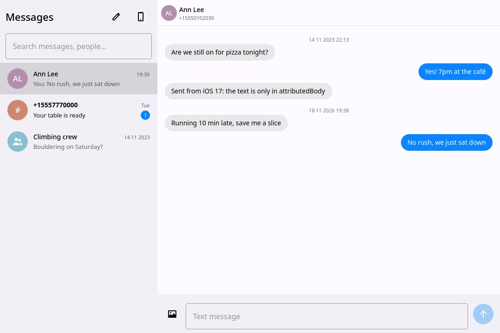

# nexora-msg: your iPhone's messages on Nexora

Texts, pictures, contacts and search for the messages on your iPhone, from Nexora: over **Bluetooth** for what
arrives while you work, and over the **cable** for the whole history with its pictures. A small **companion app** on
the iPhone, sideloaded, adds sending pictures and contacts with their photos.

    nexora-msg                    # the window
    nexora-msg sync               # back up over the cable and import (only changes after the first time)
    nexora-msg import FOLDER      # an existing, unencrypted iPhone backup (or Finder/iTunes's)
    nexora-msg search pizza 7pm   # messages, people and conversations
    nexora-msg chats | devices | stats

## What iOS allows, and how nexora-msg works with it

iOS lets no app, and no computer, read iMessage directly: there is no API for it, on the phone or off it. What there
is, nexora-msg uses:

| | Bluetooth (MAP, PBAP) | Cable (backup) | Companion app |
|---|---|---|---|
| New messages, as they arrive | yes (notifications) | at the next sync | no |
| The whole history | the recent messages | yes | no |
| Pictures you receive | no | yes | no |
| Sending a text | yes | no | yes (one tap on the phone) |
| Sending a picture | no | no | yes (one tap on the phone) |
| Contacts | yes | yes | yes, with photos |

- **Bluetooth.** Pair the iPhone with the computer once (Settings > Bluetooth), then on the iPhone tap (i) next to
  the computer and turn on **Show Notifications** (messages, over MAP) and **Sync Contacts** (PBAP). This is what car
  head units use. BlueZ's obexd (package `bluez-obex`) carries both.
- **Cable.** libimobiledevice makes a local backup (unlock the phone and tap **Trust** the first time), and the Rust
  store reads the messages (`sms.db`), their pictures and the address book out of it. The backup must not be
  encrypted ("Encrypt local backup" off), since nexora-msg cannot read an encrypted one. After the first time only
  changes are copied. A Mac's `~/Library/Messages/chat.db` imports too (same format).
- **Companion app** (`ios/`, "Nexora Messages"). iOS never lets an app send a message without you, so a picture
  from the computer opens in Messages' own sheet on the phone, filled in, and you tap Send (a notification brings
  the app forward if it was in the background). It also gives the computer your contacts with photos. It keeps
  running in the background by playing silence, as SideStore does (mixed with your audio, so nothing is
  interrupted). It cannot read your messages; iOS forbids that too.

The same message from two places (Bluetooth now, the backup later) is kept once: the backup's copy, which has
the exact time and the pictures, replaces the Bluetooth one.

## Over Tailscale

Everything that goes over the network also goes over [Tailscale](https://tailscale.com), so it works away from home:

- **Companion app:** with Tailscale on the iPhone, the computer finds it on the tailnet by itself, when there is no
  cable and it is not on the same Wi-Fi. You can also type its Tailscale name or address. The app listens on every
  interface, the Tailscale one included.
- **Remote desktop:** the computers on your tailnet that share their desktop are listed in the remote desktop
  dialog, and rdp-express listens on its Tailscale addresses by default.

`nexora-msg remote` lists those computers from the command line.

## Remote desktop

Messages can also show another computer's desktop, and you can use it with your mouse and keyboard: the button
next to the phone opens it. The other computer runs **rdp-express**, a separate package (`nexora-rdp-express`, in
`apps/rdp-express`): a small Rust server that shares a Wayland desktop (Hyprland, sway, wlroots) over its own
protocol.

- **Encrypted:** X25519 keys and ChaCha20-Poly1305. The first time, the code from `rdp-express pair` on that
  computer pairs the viewer; after that it connects without one.
- **Express:** only the changed parts of the screen are sent, as JPEG tiles, and only as fast as the viewer takes
  them. In testing, a keypress in a terminal cost 2 to 9 KB.

The remote desktop opens in its own window, with Ctrl+Alt+Enter for full screen and a quality slider.

    nexora-msg remote                               # computers on your tailnet that share their desktop
    nexora-msg remote desk --code "1234 5678"       # pair with one (the code from `rdp-express pair` there)
    nexora-msg remote desk --snapshot desk.png      # a picture of its screen

## Inside

- `core/` (Rust): the store, one SQLite file in `~/.local/share/nexora-msg/` with full-text search (FTS5, accents
  and prefixes: "cafe stat" finds "café near the station"). It also holds the backup importer. It reads iOS 16+
  messages whose text is only in `attributedBody` (a typedstream NSAttributedString), skips reactions (tapbacks),
  copies attachments out of the backup, and matches people by their numbers' last ten digits or their email. The app
  runs it as a service (`nexora-msg-core serve STORE`, JSON lines).
- `nexora_msg/` (Python 3.14 and 3.15): the remote desktop viewer (`rdp.py`, `rdpview.py`), Tailscale
  (`tailscale.py`), Bluetooth (`bluetooth.py`: obexd over D-Bus, bMessage and vCard parsing),
  the cable (`wired.py`: idevicebackup2), the companion link (`companion.py`, `usbmux.py`), and the window's bridge
  (`app.py`).
- `nexora_msg/qml/` (Qt 6.12, Qt Quick Controls Material): conversations, bubbles with pictures, search, new
  message, and the iPhone dialog. Coloured by Halcyon's theme when there is one.
- `ios/` (Swift, SwiftUI, iOS 16+): the companion app. `xcodegen generate` makes the Xcode project, and
  `ios/scripts/build-ipa.sh` builds an unsigned `.ipa`. CI (`.github/workflows/msg.yml`) builds it on macOS and
  publishes it to the `nexora-msg-ios` release. Install it with SideStore, AltStore or Sideloadly, which sign it
  with your Apple ID (a free account works; re-sign every 7 days, which SideStore does by itself).

### The companion link

It runs over TCP port 47800, through usbmuxd over the cable or on Wi-Fi (Bonjour `_nexoramsg._tcp`; type the
iPhone's address if Avahi is not running). Frames are a 4-byte big-endian length followed by the payload.

1. The computer and the phone exchange hellos in the clear: each sends its X25519 public key and a random nonce.
2. Each side computes the shared secret. HKDF-SHA256 turns it into a ChaCha20-Poly1305 key for this connection,
   salted with both nonces. Every later frame is encrypted with a counter nonce for each direction, so a replayed or
   altered frame is refused.
3. The first time, both sides show the same six-digit code, derived from the shared secret. You check that they
   match and tap **Pair** on the phone. The phone then remembers the computer's key.

## Tests

    cd core && cargo test
    NEXORA_MSG_CORE=core/target/debug/nexora-msg-core python -m pytest tests   # Python 3.14 or 3.15

`tests/fakephone.py` makes an iPhone backup to test against: an iOS 17 message, a group chat with a picture, a
reaction and the address book. The companion test runs the iPhone side of the protocol in Python.
